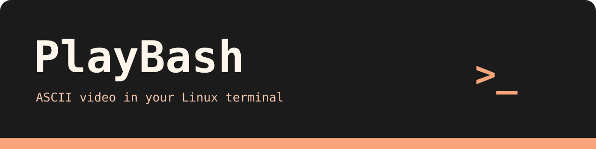
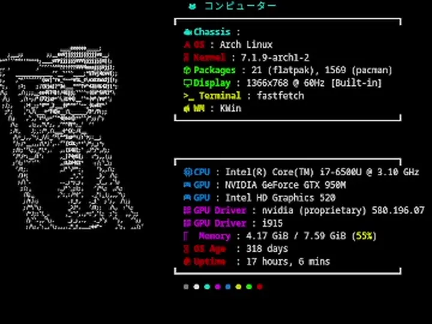
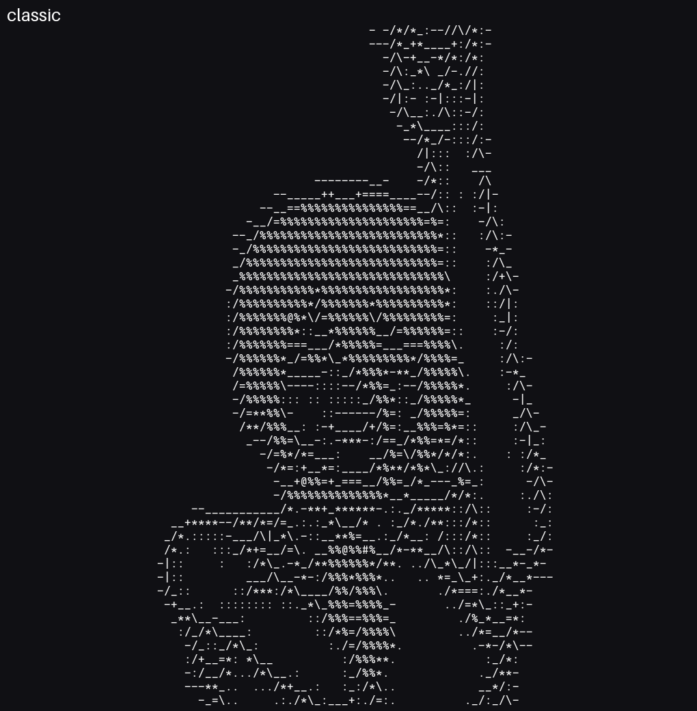
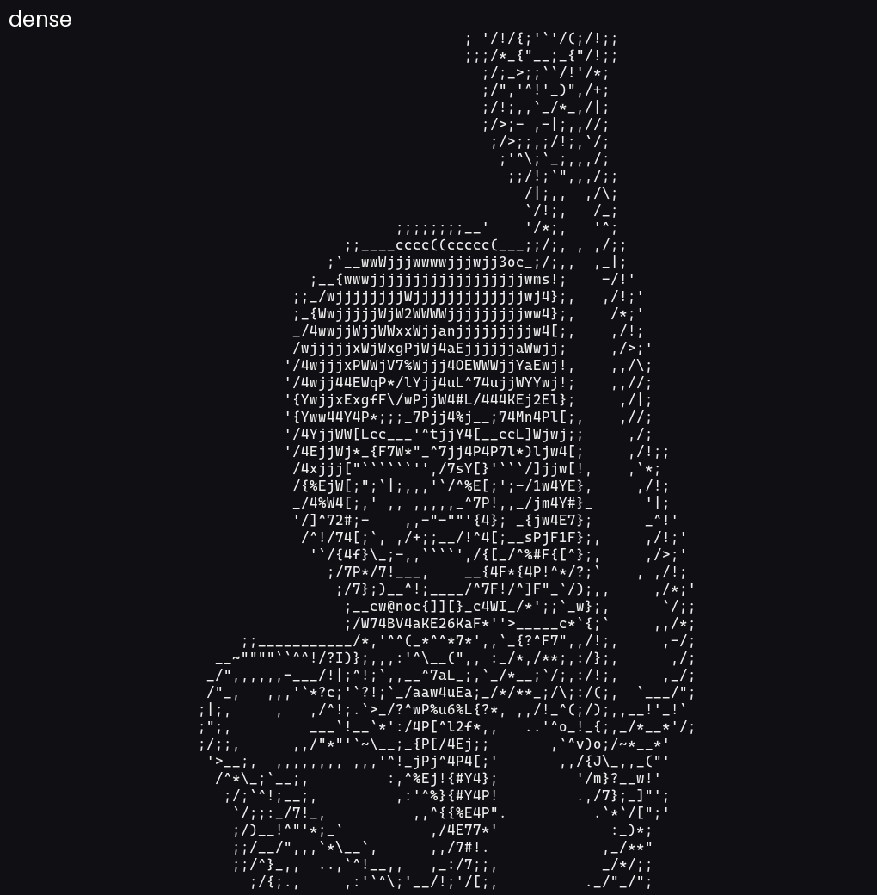
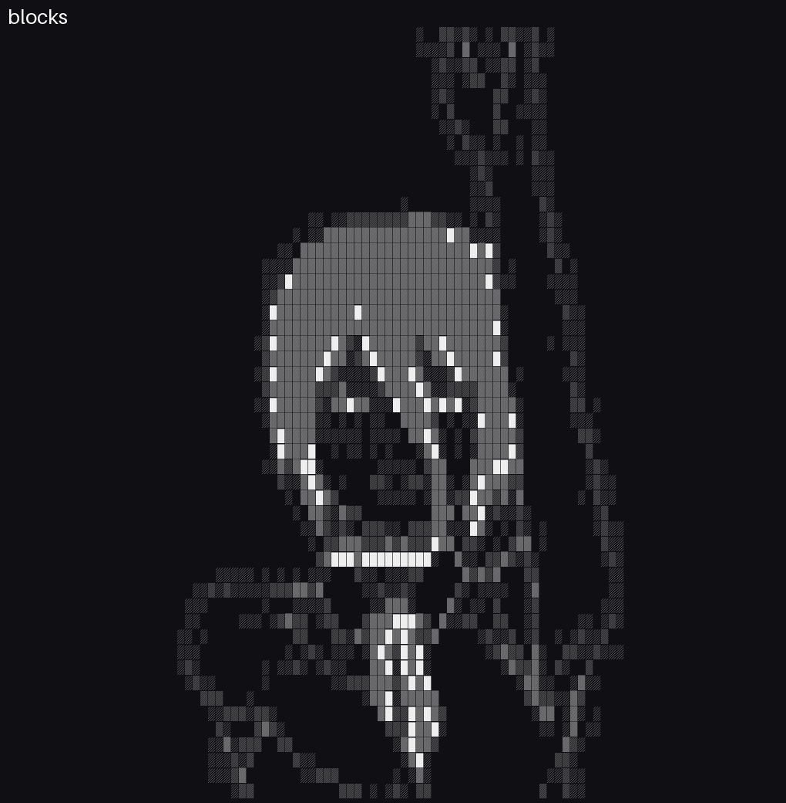

# PlayBash

PlayBash plays local videos as ASCII art in a Linux terminal and can turn the Fastfetch logo into a looping clip.

[Project site preview](docs/index.html) · [Watch the demo (MP4)](docs/media/playbash-demo.mp4)

## Demo

[](docs/media/playbash-demo.mp4)

| Classic | Dense | Blocks |
| --- | --- | --- |
|  |  |  |

## Features

- Six rendering modes: `classic`, `dense`, `blocks`, `matrix`, `hex`, and `binary`.
- Optional video colors, configurable frame rate, and automatic replay.
- A local video library with numbered entries and a shortcut to the last played video.
- Animated Fastfetch logos with zoom, positioning, and a saved default.

## New in v0.9.1

Cached Fastfetch logos start with **about 92% less waiting (12.8× startup speedup)** in a local benchmark: 2.80 s before caching versus 0.22 s on repeat opens. The first open for a new video or layout still prepares its frames. All six modes have expanded symbol sets: classic 21, dense 103, blocks 18, matrix 9, hex 20, and binary 6, excluding spaces. See the [release notes and measurement details](CHANGELOG.md).

## Quickstart

Use Linux with Bash, Git, and Python 3.10 or newer with pip and venv. The installer creates `.venv` and a launcher at `~/.local/bin/playbash`.

```bash
git clone https://github.com/thmanmr976-dot/PlayBash.git
cd PlayBash
bash install.sh
export PATH="$HOME/.local/bin:$PATH"
playbash version
```

The last command prints the installed version. Replace `/path/to/video.mp4` below with a local clip, then press `q` to stop playback.

```bash
playbash run "/path/to/video.mp4" --mode dense
```

FFmpeg and ffprobe provide a fallback when OpenCV cannot decode a clip. Animated logos also require Fastfetch.

## Video library

```bash
playbash add "/path/to/video.mp4"
playbash list
playbash run 1
playbash run
playbash remove 1
```

`playbash run` with no argument reopens the last video played. `playbash clear` empties the library.

## Animated Fastfetch logo

```bash
playbash fastfetch 1 --adjust
```

Use the arrow keys to move the clip and `+` or `-` to zoom. Press Enter to save it as the default logo or `q` to close the preview. You can also pass a video path or preview without `--adjust`.

The first save installs a per-user Fastfetch launcher and integrates it with Bash startup. Open a fresh Bash terminal and run `fastfetch` to see the saved logo. `playbash fastfetch` also opens it directly. Use `playbash fastfetch --stop` to stop the current animation and `playbash fastfetch --reset-logo` to restore the original logo for future calls.

## Configuration

```bash
playbash config
playbash config --mode dense --fps 24 --color
playbash config --no-loop
playbash config --reset
```

The default mode is `classic`, regular playback is set to 30 FPS, replay is on, and colors are off. Set `--loop` or `--no-color` independently. A single `run` can override the configured mode and frame rate with `--mode` and `--fps`.

## Development

After installation, run the tests with `.venv/bin/python -m unittest discover -s tests -q`. The Fastfetch integration tests use Fastfetch, FFmpeg, ffprobe, and Bash. For changes, describe the terminal, rendering mode, and playback steps in the pull request.

## Site preview

From the repository root:

```bash
python3 -m http.server 8000 --bind 127.0.0.1 --directory docs
```

Open [the local preview](http://127.0.0.1:8000/). After review and merge, select `main` and `/docs` as the GitHub Pages publishing source. The [project Pages URL](https://thmanmr976-dot.github.io/PlayBash/) becomes available once Pages is enabled.
