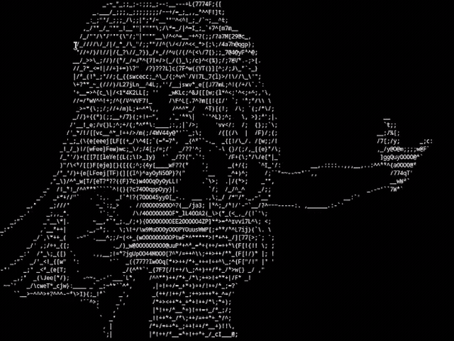

# PlayBash

**PlayBash** is a terminal-based video player that converts videos into ASCII art and plays them directly inside your Linux terminal.

> 🚧 **Current version: v0.8.0**

## Demo

[](docs/media/playbash-demo.mp4)

[Watch the MP4](docs/media/playbash-demo.mp4)

## ✨ Features

* 🎬 Play videos directly in the terminal
* 🖥️ Automatically adapts to the terminal size
* 🎨 Multiple ASCII rendering modes
* 📚 Built-in video library
* ⚙️ Configurable playback FPS and rendering mode
* 📌 Remembers the last played video
* 🐍 Python-based
* 📦 Easy installation with `install.sh`
* 🌍 Works across Linux distributions with Python 3
* 🚀 Run `playbash` from any directory after installation

## 📦 Installation

### 1. Clone the repository

```bash
git clone https://github.com/thmanmr976-dot/PlayBash.git
```

### 2. Enter the project directory

```bash
cd PlayBash
```

### 3. Run the installer

```bash
./install.sh
```

The installer will:

* Check for Python 3
* Check for pip
* Create a virtual environment
* Install PlayBash and its dependencies
* Create the `playbash` command
* Configure the command for use from any directory

After installation:

```bash
playbash version
```

## 🎮 Usage

### Play a video

```bash
playbash run /path/to/video.mp4
```

You can also play a video from the library:

```bash
playbash run 1
```

### Play the last video

```bash
playbash run
```

### Add a video to the library

```bash
playbash add /path/to/video.mp4
```

### List videos

```bash
playbash list
```

Example:

```text
PlayBash Library

1. video.mp4
2. movie.webm
3. animation.mkv
```

### Remove a video

```bash
playbash remove 1
```

### Clear the library

```bash
playbash clear
```

## 🎨 Rendering Modes

PlayBash supports multiple rendering modes:

* `classic`
* `dense`
* `blocks`
* `matrix`
* `hex`
* `binary`

Select a mode when playing a video:

```bash
playbash run video.mp4 --mode dense
```

Or configure the default mode:

```bash
playbash config --mode dense
```

## ⚙️ Configuration

View the current configuration:

```bash
playbash config
```

Change the default FPS:

```bash
playbash config --fps 30
```

Change the default rendering mode:

```bash
playbash config --mode classic
```

Reset the configuration:

```bash
playbash config --reset
```

## 📋 Command Reference

| Command                         | Description                |
| ------------------------------- | -------------------------- |
| `playbash run <video>`          | Play a video               |
| `playbash run <index>`          | Play a library video       |
| `playbash run`                  | Play the last video        |
| `playbash add <video>`          | Add a video to the library |
| `playbash list`                 | List library videos        |
| `playbash remove <index>`       | Remove a library video     |
| `playbash clear`                | Clear the library          |
| `playbash config`               | View configuration         |
| `playbash config --mode <mode>` | Change rendering mode      |
| `playbash config --fps <fps>`   | Change FPS                 |
| `playbash config --reset`       | Reset configuration        |
| `playbash version`              | Show PlayBash version      |

## 🛠️ Requirements

* Linux
* Python 3
* pip
* A terminal capable of displaying standard text/ANSI output

PlayBash automatically installs its Python dependencies during installation.

## 📁 Project Structure

```text
PlayBash/
├── playbash/
│   ├── cli/
│   │   └── parser.py
│   ├── core/
│   │   ├── ascii.py
│   │   ├── charset.py
│   │   ├── config.py
│   │   ├── imagefx.py
│   │   ├── input.py
│   │   ├── player.py
│   │   └── renderer.py
│   ├── data/
│   │   ├── config.json
│   │   └── library.json
│   ├── library.py
│   ├── settings.py
│   └── __main__.py
│
├── install.sh
├── pyproject.toml
├── README.md
├── CHANGELOG.md
└── ROADMAP.md
```

## 🧪 Development

Clone the repository:

```bash
git clone https://github.com/thmanmr976-dot/PlayBash.git
cd PlayBash
```

Create a virtual environment:

```bash
python3 -m venv .venv
```

Activate it:

```bash
source .venv/bin/activate
```

Install PlayBash in editable mode:

```bash
python -m pip install -e .
```

Run the development version:

```bash
python -m playbash version
```

## 🗺️ Roadmap

See [ROADMAP.md](ROADMAP.md) for planned features and future development.

## 📜 Changelog

See [CHANGELOG.md](CHANGELOG.md) for version history.

## 🤝 Contributing

PlayBash is an evolving project.

Bug reports, ideas, improvements, and contributions are welcome.

## 📄 License

License information will be added in a future release.
